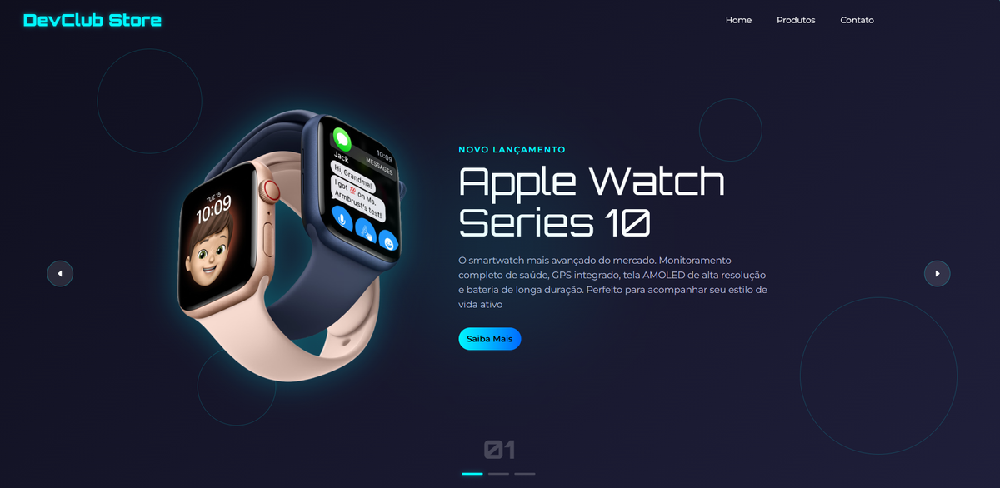

# DevClub Store — Vitrine Interativa de Produtos

Vitrine de produtos com carrossel automático, animações e layout responsivo, desenvolvida com **HTML5, CSS3 e JavaScript puro**. Projeto criado a partir de uma aula do **Rodolfo Mori (DevClub)** e usado para praticar os fundamentos do Front-End: manipulação do DOM, eventos, animações e responsividade.



## Funcionalidades

- Carrossel automático com troca de produto a cada 5 segundos
- Navegação manual por setas (ícones em SVG), com loop infinito entre os itens
- Indicadores de posição: contador numérico e barras de progresso
- Animações de entrada dos textos e da imagem, com transições suaves entre produtos
- Efeito _hover_ no botão "Saiba Mais" (escala, brilho e sombra)
- Animação de sublinhado nos itens do menu
- Efeito _pulse_ no plano de fundo
- Layout responsivo para desktop, notebook, tablet e celular (retrato e paisagem)
- Identidade visual com as fontes **Orbitron** e **Montserrat**

## Tecnologias

| Tecnologia | Uso                                             |
| ---------- | ----------------------------------------------- |
| HTML5      | Estrutura semântica da página                   |
| CSS3       | Layout, animações, transições e _media queries_ |
| JavaScript | Lógica do carrossel e interatividade            |

## O que pratiquei

- Seleção e manipulação do DOM
- Eventos de clique
- Temporizadores com `setInterval()`
- Controle de estado da interface por meio de classes CSS
- Animações e transições em CSS
- Responsividade com _media queries_, Flexbox e unidades relativas

## Estrutura do projeto

```
├── img/
│   ├── air-pods.png
│   ├── apple-watch.png
│   ├── preview.png
│   └── vision-pro.png
├── index.html
├── README.md
├── script.js
└── styles.css
```

## Como executar

1. Clone o repositório:
   ```bash
   git clone https://github.com/joseluizp/DevClub-Store.git
   ```
2. Abra a pasta do projeto.
3. Abra o arquivo `index.html` no navegador.

Não é necessário instalar dependências.

## Responsividade

O layout se adapta a diferentes telas, preservando a identidade visual do desktop:

- **Acima de 1100px:** layout original
- **Até 1100px:** ajuste de tipografia e espaçamentos
- **Até 900px:** imagem e texto empilhados
- **Até 600px:** setas posicionadas na base, ao lado dos indicadores
- **Até 480px:** cabeçalho em duas linhas
- **Paisagem em telas baixas:** layout compacto lado a lado

## Autor

**José Luiz Júnior**
Em formação para Desenvolvedor Full Stack, em busca de oportunidade de estágio ou posição júnior.

[LinkedIn](https://www.linkedin.com/in/jose-luiz-jr03/) | [GitHub](https://github.com/Joseluizp)

## Créditos

Projeto baseado em aula do **Rodolfo Mori** na **DevClub**.
